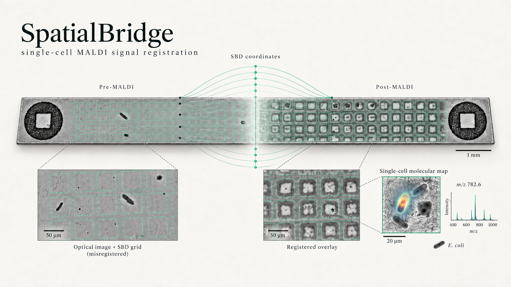
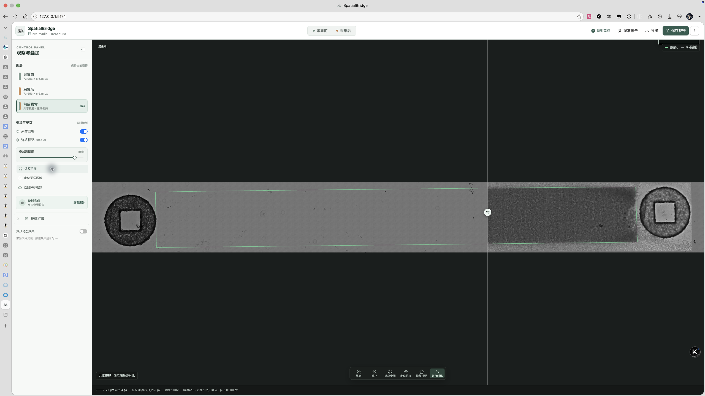
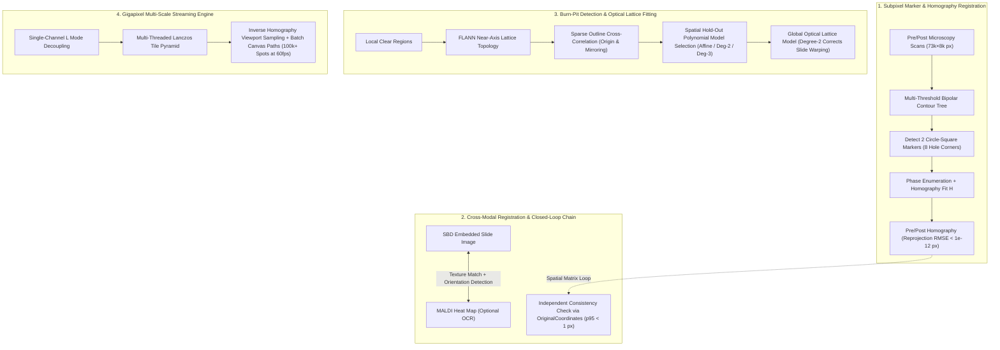
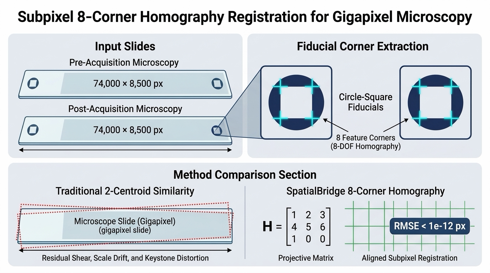
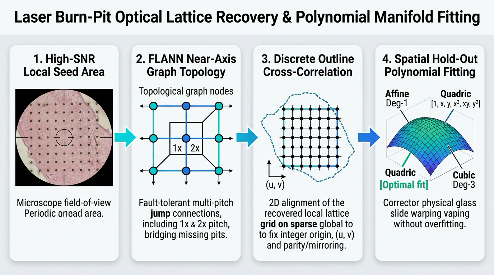
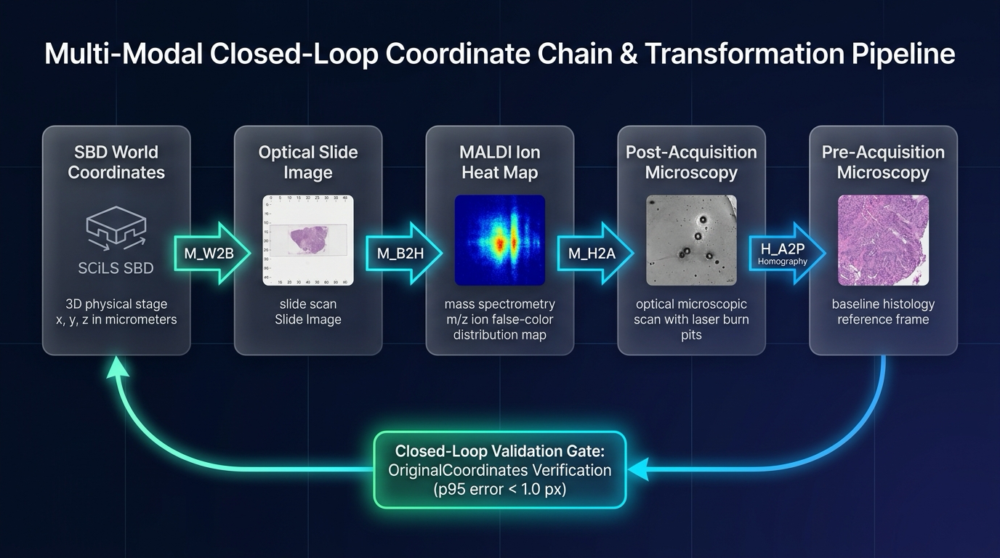

<p align="center">
  
</p>

<h1 align="center">SpatialBridge</h1>

<p align="center">
  Automatic registration and linked viewing of pre/post-acquisition microscopy and MALDI spatial data
</p>

<p align="center">
  <a href="https://github.com/SmartisanNaive/SpatialBridge/actions/workflows/ci.yml"></a>
  <a href="LICENSE"></a>
  
  
</p>

<p align="center">
  <a href="README.md">简体中文</a> | English
</p>

---

SpatialBridge reads per-spot coordinates and normalization values from a SCiLS SBD file. Together with a MALDI heat map and two microscopy PNGs, it builds the coordinate chain `SBD world → slide image pixel → heat map pixel → microscopy PNG pixel` and confirms laser burn pits on the post-acquisition image. Source files are opened read-only. Project caches and manual annotations are stored separately.



## Features

- **Automatic registration**: texture matching between the slide image and heat map, plus an independent consistency check against SBD `OriginalCoordinates`.
- **Burn-pit lattice detection**: fits a regular lattice from clear regions and selects a smoothing model with a spatial hold-out set.
- **Large-image viewer**: OpenSeadragon tiles with pre, post and swipe comparison views; draws 100k+ spot footprints smoothly.
- **Spot lookup and annotation**: click any spot to see its SBD record and all normalization values; export manual points as CSV.
- **Heat map overlay**: detects heat map rotation and mirroring automatically, then colors each SBD spot.
- **Large uploads**: the browser extracts SBD coordinates, normalization values and optical images before uploading a compact package; PNGs are losslessly optimized locally when useful, with already-compressed images reused; 16 MiB chunks, SHA-256 verification, adaptive gzip, resumable transfers.
- **Single-container deployment**: Docker Compose on a Linux server, with data persisted on the host.



## Architecture & CV Pipeline

To address the challenges of gigapixel microscopy scans (typically $74,000 \times 8,500$ pixels, $\sim 630\text{ Mpx}$), subtle laser ablation marks, and cross-modal imaging discrepancies, SpatialBridge incorporates a four-stage, high-precision computer vision pipeline:



### Key CV Pipeline Strengths

1. **8-Corner Hole Homography (Overcoming 2-Centroid Similarity Limits)**
   - **Challenge**: Over ultra-wide slide scans ($74,000 \times 8,500$ px), mechanical stage feed errors and optical distortions introduce subtle scale drift, shear, and keystone skew across the long axis. Standard 2-marker centroid similarity transforms (4 degrees of freedom) cannot capture these non-rigid deformations.
   - **Solution**: Using topological contour tree analysis (`RETR_TREE`), SpatialBridge detects the square inner cavity within both circular markers, extracting all **8 hole corners**. By enumerating 4 cyclic phases and reflections, it fits an 8-DOF homography matrix $H \in \mathbb{R}^{3 \times 3}$, pushing the reprojection RMSE down to floating-point machine precision ($< 10^{-12}\text{ px}$) for exact subpixel alignment.

   

2. **Laser Burn-Pit Detection & Polynomial Optical Lattice (Evolving SpaceM Concepts)**
   - **Challenge**: Non-uniform tissue thickness and low local contrast cause standard direct object detectors to suffer high false negatives or noise-induced false positives.
   - **Solution**: Inspired by SpaceM's principle of recovering regular lattice topology from high-SNR regions first, the system identifies local Gaussian response peaks and links near-axis neighbours via FLANN (tolerating 1–2 missing nodes). It aligns integer origin and mirror orientation against the SBD's sparse footprint outline via discrete cross-correlation. Finally, it uses a **spatial hold-out set** to benchmark affine, degree-2, and degree-3 polynomial surface models, adaptively selecting `sbd-optical-lattice-v2-degree2` ($[1, x, y, x^2, xy, y^2]$) to correct physical slide warping while strictly avoiding overfitting.

   

3. **Closed-Loop Multi-Modal Coordinate Chain**
   - Establishes a seamless, continuous coordinate mapping:
     $$\text{SBD World} \xrightarrow{\text{World2Px}} \text{Slide Pixel} \xrightarrow{\text{Texture Match}} \text{Heat Map Pixel} \xrightarrow{H} \text{Post-Acquisition Pixel} \xrightarrow{H^{-1}} \text{Pre-Acquisition Pixel}$$
   - Uses SBD `OriginalCoordinates` for independent geometric loop closure, enforcing a strict $p95 < 1\text{ px}$ validation gate to guarantee spot-level fidelity.

   

4. **Single-Channel Decoupled Gigapixel Tile Engine**
   - Keeps single-channel grayscale (`L` mode) throughout pyramid construction to avoid expanding a 630 Mpx image into multi-gigabyte RGBA memory buffers.
   - Generates OpenSeadragon-compliant multi-resolution pyramids via multi-threaded Lanczos downsampling. At runtime, it performs inverse projective viewport sampling and batch Canvas path rendering, enabling smooth 60fps swipe comparison across 100k+ spot footprints.

## Quick start

### Requirements

- Python 3.11+ and [uv](https://docs.astral.sh/uv/)
- Node.js 22+ and npm
- Optional: [libvips](https://www.libvips.org/) (faster large-image processing with `--extra tiles`) and [Tesseract](https://github.com/tesseract-ocr/tesseract) (reads the m/z label on heat maps)

### Run locally

```bash
# Backend (http://127.0.0.1:8000 by default)
uv sync --extra tiles --extra dev
uv run spatialbridge serve --data-dir ./workspace-data

# Frontend, in a second terminal (http://localhost:5173 by default)
cd frontend
npm install
npm run dev
```

Open `http://localhost:5173`. On the project home page, select the pre-acquisition PNG, the post-acquisition PNG, and optionally the SBD file and a heat map. You don't need to upload the slide image, because the SBD embeds the slide image and coordinate matrices that SCiLS used for registration.

If a `参考数据/` sample directory exists in the project root, click "载入内置示例" (load built-in demo) to try the full workflow. Sample data is not distributed with the repository.

> [!NOTE]
> The `.venv` created by uv records absolute paths. After moving or renaming the project directory, delete `.venv` and run `uv sync --extra tiles --extra dev` again. Rebuild `frontend/node_modules` with `npm install` the same way.

### Command line

```bash
# Start the web service
uv run spatialbridge serve --data-dir ./workspace-data [--host 127.0.0.1] [--port 8000] [--frontend-dir frontend/dist]

# Register a source directory and write a report
uv run spatialbridge register --source-dir ./参考数据 --output-dir ./workspace-data/manual-check
```

The database, upload chunks, reports and caches all live under `--data-dir`. Nothing is written into the source directory.

### Server deployment

```bash
cp .env.example .env
sudo install -d -o 10001 -g 10001 -m 0770 /srv/spatialbridge/data
sudo docker compose up -d --build
```

See the [deployment guide](docs/deployment.md) (Chinese) for configuration, updates, backup and restore, and usage limits.

## Documentation

The full documentation index is available at [docs/README.md](docs/README.md) (in Chinese).

| Document | Contents |
| --- | --- |
| [docs/technical-architecture.md](docs/technical-architecture.md) | CV pipeline deep-dive, 8-corner homography derivation, FLANN lattice fitting, closed-loop coordinate chain, and WASM extraction |
| [docs/deployment.md](docs/deployment.md) | Comprehensive deployment & operations guide: development setup, Linux Docker Compose, macOS Apple Container, capacity planning, Nginx TLS, and disaster recovery |
| [docs/algorithm.md](docs/algorithm.md) | Coordinate conventions ($xy$/$yx$), output specifications, workbench interaction logic, and HTTP REST API |
| [docs/development-guide.md](docs/development-guide.md) | Architecture decoupling principles, memory protection guidelines, coding standards, 3-tier test gates, and Conventional Commits |
| [CONTRIBUTING.md](CONTRIBUTING.md) | Quick contributor onboarding guide and Pull Request workflow |

## Project layout

```text
.
├── backend/spatialbridge/   FastAPI backend: registration, lattice, heat map, tiles, storage, CLI
├── frontend/                React + Vite + OpenSeadragon frontend
│   ├── src/                 Page components and pure logic modules
│   └── tests/               Frontend unit tests (node:test)
├── tests/                   Backend pytest suite
├── docs/                    Documentation and images
├── Dockerfile.api           Combined frontend + backend image
├── compose.yaml             Docker Compose service
└── .env.example             Deployment configuration template
```

## Limitations

- Heat map colors are sampled from the rendered image. They approximate the signal and are not raw m/z ion intensities.
- A slide-texture match alone does not prove that a heat map comes from the same acquisition. Check the sample provenance.
- The server runs in shared mode, with no accounts, permissions, per-user data isolation or built-in TLS.
- The container image has passed build, real two-PNG processing and persistence checks across container recreation on macOS Apple Container (Linux/ARM64). Acceptance on a real Linux server is still pending; see the [validation record and acceptance checklist](docs/deployment.md#本地容器验证记录).

## Acknowledgements

- [SpaceM](https://github.com/alexandrovteam/SpaceM): approach to burn-pit lattice detection
- [napari-imsmicrolink](https://github.com/nhpatterson/napari-imsmicrolink): IMS coordinate matrix orientation conventions
- [OpenSeadragon](https://openseadragon.github.io/): large-image tile viewer

## License

[MIT](LICENSE)
