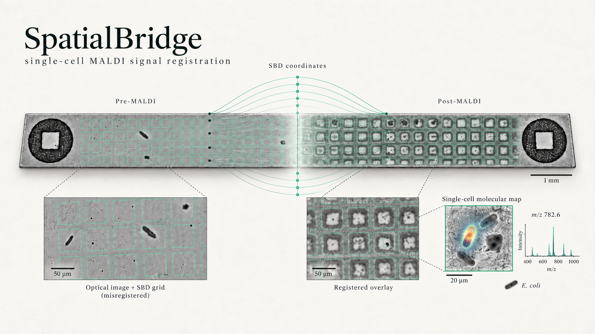

<p align="center">
  
</p>

<h1 align="center">SpatialBridge</h1>

<p align="center">
  采集前/采集后显微图与 MALDI 空间数据的自动配准与联动查看工具
</p>

<p align="center">
  <a href="https://github.com/SmartisanNaive/SpatialBridge/actions/workflows/ci.yml"></a>
  <a href="LICENSE"></a>
  
  
</p>

<p align="center">
  简体中文 | <a href="README.en.md">English</a>
</p>

---

SpatialBridge 读取 SCiLS SBD 文件中的逐点坐标和 normalization 值，结合 MALDI 热图与两张显微 PNG，建立 `SBD world → 板图像素 → 热图像素 → 显微 PNG 像素` 的坐标链，并在采集后图像上确认激光灼烧坑。来源文件只读，项目缓存和人工标记单独保存。



## 功能

- **自动配准**：板图与热图纹理匹配，加上 SBD `OriginalCoordinates` 的独立一致性检查。
- **灼烧坑晶格检测**：从清晰区域拟合规则晶格，并用空间留出集选择平滑模型。
- **大图浏览**：基于 OpenSeadragon 的瓦片浏览，支持采集前、采集后和前后卷帘对比，十万级 spot 方框流畅绘制。
- **点位查询与标注**：点击任意 spot 查看 SBD 信息和全部 normalization 值，人工赋值点可导出 CSV。
- **热图叠加**：自动识别热图旋转和镜像，并按 SBD 点位显示颜色。
- **大文件上传**：16 MiB 分片、SHA-256 校验、按需 gzip 压缩、断点续传。
- **单容器部署**：Docker Compose 一键部署到 Linux 服务器，数据持久化在宿主机。


## 快速开始

### 环境要求

- Python 3.11+ 和 [uv](https://docs.astral.sh/uv/)
- Node.js 22+ 和 npm
- 可选：[libvips](https://www.libvips.org/)（配合 `--extra tiles` 加速大图处理）、[Tesseract](https://github.com/tesseract-ocr/tesseract)（读取热图上的 m/z 标签）

### 本地运行

```bash
# 后端（默认 http://127.0.0.1:8000）
uv sync --extra tiles --extra dev
uv run spatialbridge serve --data-dir ./workspace-data

# 前端（另开一个终端，默认 http://localhost:5173）
cd frontend
npm install
npm run dev
```

打开 `http://localhost:5173`，在项目首页选择采集前 PNG、采集后 PNG，以及可选的 SBD 和热图。板图不需要上传，SBD 内嵌了 SCiLS 配准用的板图及坐标矩阵。

如果项目根目录下有 `参考数据/` 示例目录，可以直接点击“载入内置示例”体验完整流程。示例数据不随仓库发布。

> [!NOTE]
> uv 创建的 `.venv` 记录了绝对路径。移动或重命名项目目录后，删除 `.venv` 并重新执行 `uv sync --extra tiles --extra dev`；`frontend/node_modules` 同理用 `npm install` 重建。

### 命令行

```bash
# 启动 Web 服务
uv run spatialbridge serve --data-dir ./workspace-data [--host 127.0.0.1] [--port 8000] [--frontend-dir frontend/dist]

# 对一个来源目录执行配准并输出报告
uv run spatialbridge register --source-dir ./参考数据 --output-dir ./workspace-data/manual-check
```

数据库、上传分片、报告和缓存都写在 `--data-dir` 下，不会写入来源目录。

### 服务器部署

```bash
cp .env.example .env
sudo install -d -o 10001 -g 10001 -m 0770 /srv/spatialbridge/data
sudo docker compose up -d --build
```

配置项、更新、备份恢复和使用边界见 [部署文档](docs/deployment.md)。

## 文档

| 文档 | 内容 |
| --- | --- |
| [docs/deployment.md](docs/deployment.md) | Linux 部署、配置、运维、备份恢复、验收清单 |
| [docs/algorithm.md](docs/algorithm.md) | 坐标链、晶格检测、输出文件、工作台交互、HTTP API |
| [CONTRIBUTING.md](CONTRIBUTING.md) | 开发环境、测试、代码结构、提交规范 |

## 项目结构

```text
.
├── backend/spatialbridge/   FastAPI 后端：配准、晶格、热图、瓦片、存储、CLI
├── frontend/                React + Vite + OpenSeadragon 前端
│   ├── src/                 页面组件与纯逻辑模块
│   └── tests/               前端单元测试（node:test）
├── tests/                   后端 pytest
├── docs/                    文档与配图
├── Dockerfile.api           前后端一体化镜像
├── compose.yaml             Docker Compose 服务定义
└── .env.example             部署配置模板
```

## 局限

- 热图颜色是渲染图片的近似采样，不是原始 m/z 离子强度。
- 板图纹理匹配不能单独证明热图与项目来自同一次采集，仍需核对样本来源。
- 服务端部署为共享模式，没有账号、权限或用户数据隔离，不内置 TLS。
- Docker 镜像尚未在真实 Linux 服务器上完成验收，见 [部署验收清单](docs/deployment.md#部署验收清单)。

## 致谢

- [SpaceM](https://github.com/alexandrovteam/SpaceM)：灼烧坑晶格检测思路
- [napari-imsmicrolink](https://github.com/nhpatterson/napari-imsmicrolink)：IMS 坐标矩阵方向约定
- [OpenSeadragon](https://openseadragon.github.io/)：大图瓦片浏览

## 许可证

[MIT](LICENSE)
