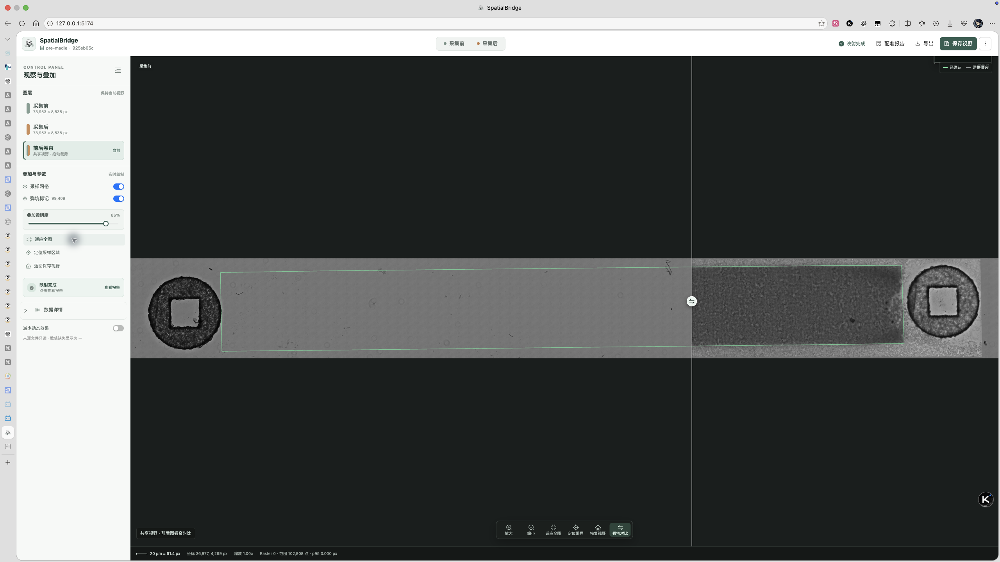
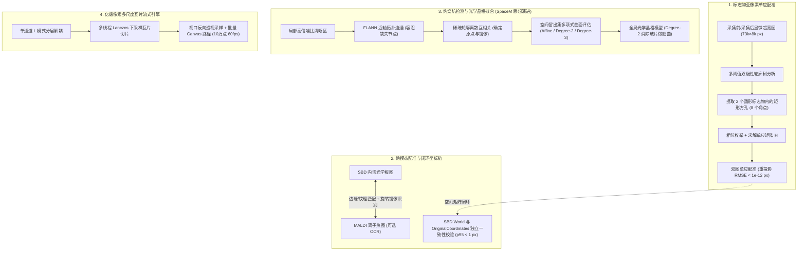
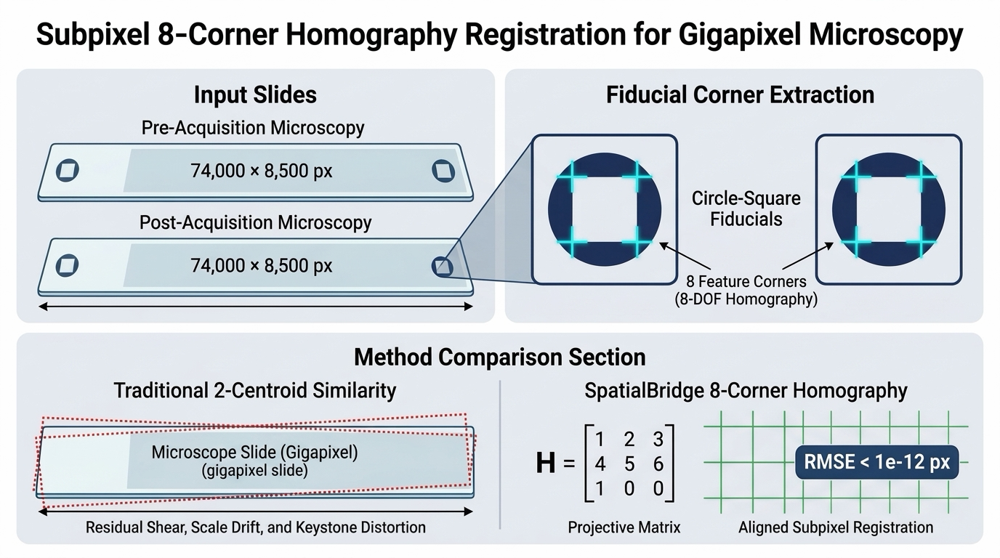
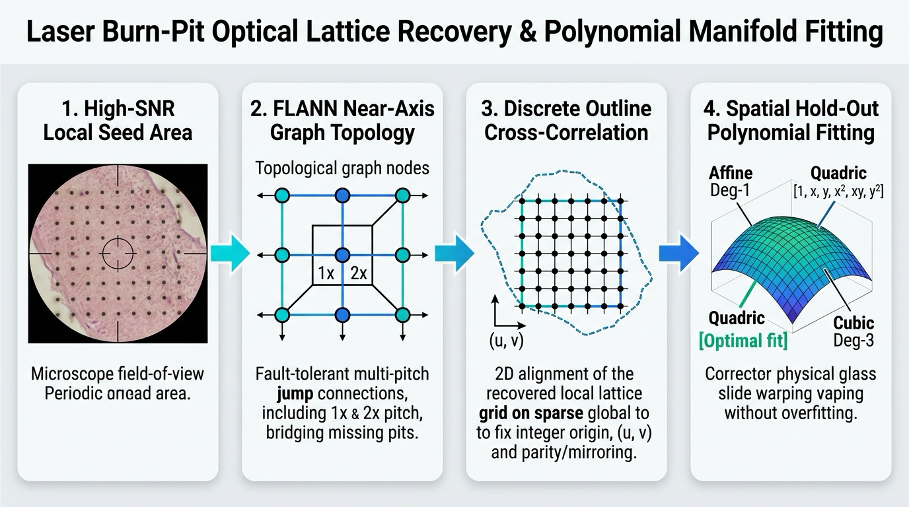
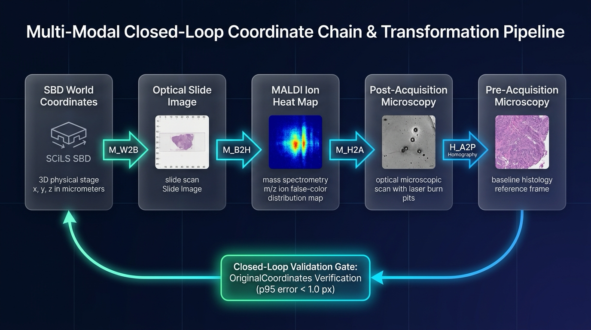

<p align="center">
  
</p>

<h1 align="center">SpatialBridge</h1>

<p align="center">
  采集前/采集后显微图与 MALDI 空间数据的自动配准与联动查看工具
</p>

<p align="center">
  <a href="https://github.com/SmartisanNaive/SpatialBridge/actions/workflows/ci.yml"></a>
  <a href="LICENSE"></a>
  
  
</p>

<p align="center">
  简体中文 | <a href="README.en.md">English</a>
</p>

---

SpatialBridge 读取 SCiLS SBD 文件中的逐点坐标和 normalization 值，结合 MALDI 热图与两张显微 PNG，建立 `SBD world → 板图像素 → 热图像素 → 显微 PNG 像素` 的坐标链，并在采集后图像上确认激光灼烧坑。来源文件只读，项目缓存和人工标记单独保存。


## 功能

- **自动配准**：板图与热图纹理匹配，加上 SBD `OriginalCoordinates` 的独立一致性检查。
- **灼烧坑晶格检测**：从清晰区域拟合规则晶格，并用空间留出集选择平滑模型。
- **大图浏览**：基于 OpenSeadragon 的瓦片浏览，支持采集前、采集后和前后卷帘对比，十万级 spot 方框流畅绘制。
- **点位查询与标注**：点击任意 spot 查看 SBD 信息和全部 normalization 值，人工赋值点可导出 CSV。
- **热图叠加**：自动识别热图旋转和镜像，并按 SBD 点位显示颜色。
- **大文件上传**：浏览器先从 SBD 提取坐标、数值和板图，仅上传精简包；PNG 在本机按需无损优化，已充分压缩的图片直接复用；16 MiB 分片、SHA-256 校验、按需 gzip 压缩、断点续传。
- **单容器部署**：Docker Compose 一键部署到 Linux 服务器，数据持久化在宿主机。



## 技术架构与算法原理（CV 管线）

针对超宽幅显微拼接图（典型尺寸 $74,000 \times 8,500$ 像素，约 6.3 亿像素）、高空间分辨率激光灼烧痕迹以及跨模态成像差异，SpatialBridge 构建了四阶段高精度计算机视觉配准管线：



### 核心 CV 算法优势

1. **8 点方孔单应配准（突破传统 2 标记圆心相似变换限制）**
   - **痛点**：在 $74,000 \times 8,500$ 像素的超长条玻片扫描中，长轴两端存在由于机械进给与光学形变导致的微小比例尺漂移、剪切角与梯形失真。传统的 2 标记圆心刚体/相似变换（只有 4 个自由度）无法拟合非刚性畸变。
   - **方案**：系统利用形态学与轮廓层次树分析（`RETR_TREE`），精确定位两个标志物内部的矩形空腔，提取全部 **8 个特征角点**。通过枚举 4 种循环相位及翻转排列，拟合 8 自由度单应矩阵 $H \in \mathbb{R}^{3 \times 3}$，将重投影 RMSE 压制至机器浮点精度（$< 10^{-12}\text{ px}$），实现亚像素级完全对齐。

   

2. **激光灼烧坑检测与光学晶格多项式拟合（借鉴并进阶 SpaceM 拓扑思想）**
   - **痛点**：生物组织薄厚不一且存在背景异物，直接进行全幅目标检测极易在低对比度区域漏检或在杂质区产生伪阳性。
   - **方案**：借鉴 SpaceM“从高信噪比区域先恢复规则晶格”的思路，首先在高对比度清晰区检测高斯响应峰；利用 FLANN 构建近轴图拓扑连接（自动容忍 1~2 个断点）；利用 SBD 稀疏点阵轮廓进行离散互相关，锁定空间原点与镜像；最后建立空间分块留出集（Spatial Hold-out Set），对比评估仿射、二阶和三阶多项式曲面模型，自适应选择 `sbd-optical-lattice-v2-degree2`（$[1, x, y, x^2, xy, y^2]$），在精准吸收长玻片非线性翘曲的同时彻底杜绝过拟合。

   

3. **双向闭环多模态坐标链验证**
   - 建立完整连通的解析坐标变换链：
     $$\text{SBD World} \xrightarrow{\text{World2Px}} \text{板图像素} \xrightarrow{\text{纹理配准}} \text{热图像素} \xrightarrow{H} \text{采集后显微像素} \xrightarrow{H^{-1}} \text{采集前显微像素}$$
   - 利用 SBD 内部物理网格 `OriginalCoordinates` 进行独立的几何反向投影与闭环一致性检验，强制执行 $p95 < 1\text{ px}$ 门禁，确保单细胞尺度的点位映射严格保真。

   

4. **单通道解耦的亿级像素流式金字塔引擎**
   - 针对超大图内存膨胀问题，切片管道维持原生的单通道灰度（`L` 模式），避免单张图在内存中膨胀为数 GB 的 RGBA 缓冲区；
   - 采用多线程 Lanczos 下采样构建 OpenSeadragon 规范的多分辨率瓦片金字塔；在线交互时基于视口四边形进行反向单应透视采样，结合批量 Canvas 路径绘制，实现 10 万+ spot 方框在前后卷帘视图下的 60fps 平滑缩放。

## 快速开始

### 环境要求

- Python 3.11+ 和 [uv](https://docs.astral.sh/uv/)
- Node.js 22+ 和 npm
- 可选：[libvips](https://www.libvips.org/)（配合 `--extra tiles` 加速大图处理）、[Tesseract](https://github.com/tesseract-ocr/tesseract)（读取热图上的 m/z 标签）

### 本地运行

```bash
# 后端（默认 http://127.0.0.1:8000）
uv sync --extra tiles --extra dev
uv run spatialbridge serve --data-dir ./workspace-data

# 前端（另开一个终端，默认 http://localhost:5173）
cd frontend
npm install
npm run dev
```

打开 `http://localhost:5173`，在项目首页选择采集前 PNG、采集后 PNG，以及可选的 SBD 和热图。板图不需要上传，SBD 内嵌了 SCiLS 配准用的板图及坐标矩阵。

如果项目根目录下有 `参考数据/` 示例目录，可以直接点击“载入内置示例”体验完整流程。示例数据不随仓库发布。

> [!NOTE]
> uv 创建的 `.venv` 记录了绝对路径。移动或重命名项目目录后，删除 `.venv` 并重新执行 `uv sync --extra tiles --extra dev`；`frontend/node_modules` 同理用 `npm install` 重建。

### 命令行

```bash
# 启动 Web 服务
uv run spatialbridge serve --data-dir ./workspace-data [--host 127.0.0.1] [--port 8000] [--frontend-dir frontend/dist]

# 对一个来源目录执行配准并输出报告
uv run spatialbridge register --source-dir ./参考数据 --output-dir ./workspace-data/manual-check
```

数据库、上传分片、报告和缓存都写在 `--data-dir` 下，不会写入来源目录。

### 服务器部署

```bash
cp .env.example .env
sudo install -d -o 10001 -g 10001 -m 0770 /srv/spatialbridge/data
sudo docker compose up -d --build
```

配置项、更新、备份恢复和使用边界见 [部署文档](docs/deployment.md)。

## 文档

完整文档导航与技术体系请查阅 [docs/README.md](docs/README.md)。

| 文档 | 内容 |
| --- | --- |
| [docs/technical-architecture.md](docs/technical-architecture.md) | 计算机视觉核心管线深度解析：8 点方孔单应配准数学推导、FLANN 晶格重构、多项式曲面留出集拟合、闭环多模态坐标链与 WASM 轻量提取 |
| [docs/deployment.md](docs/deployment.md) | 部署与运维全指南：本地原生开发部署、Linux Docker Compose 生产部署、macOS Apple Container 运行、容量规划、性能规格、Nginx TLS 与灾备恢复 |
| [docs/algorithm.md](docs/algorithm.md) | 配准方法与输出规范：坐标系与矩阵方向约定（$xy$/$yx$）、输出文件数据模型、工作台交互逻辑与 HTTP REST API |
| [docs/development-guide.md](docs/development-guide.md) | 开发规范与质量门禁：前后端分层解耦原则、内存防护机制、代码风格、三道质量测试门禁与 Conventional Commits 提交规范 |
| [CONTRIBUTING.md](CONTRIBUTING.md) | 开发者快速上手指引与 Pull Request 流程 |

## 项目结构

```text
.
├── backend/spatialbridge/   FastAPI 后端：配准、晶格、热图、瓦片、存储、CLI
├── frontend/                React + Vite + OpenSeadragon 前端
│   ├── src/                 页面组件与纯逻辑模块
│   └── tests/               前端单元测试（node:test）
├── tests/                   后端 pytest
├── docs/                    文档与配图
├── Dockerfile.api           前后端一体化镜像
├── compose.yaml             Docker Compose 服务定义
└── .env.example             部署配置模板
```

## 局限

- 热图颜色是渲染图片的近似采样，不是原始 m/z 离子强度。
- 板图纹理匹配不能单独证明热图与项目来自同一次采集，仍需核对样本来源。
- 服务端部署为共享模式，没有账号、权限或用户数据隔离，不内置 TLS。
- 容器镜像已在 macOS Apple Container（Linux/ARM64）通过构建、真实双 PNG 处理和重建持久化验证；真实 Linux 服务器仍待验收，见 [验证记录与部署验收清单](docs/deployment.md#本地容器验证记录)。

## 致谢

- [SpaceM](https://github.com/alexandrovteam/SpaceM)：灼烧坑晶格检测思路
- [napari-imsmicrolink](https://github.com/nhpatterson/napari-imsmicrolink)：IMS 坐标矩阵方向约定
- [OpenSeadragon](https://openseadragon.github.io/)：大图瓦片浏览

## 许可证

[MIT](LICENSE)
