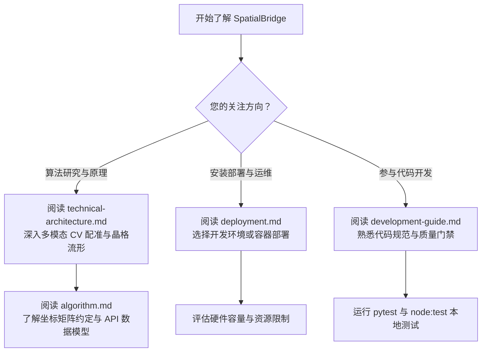

# SpatialBridge 文档体系

欢迎查阅 SpatialBridge 项目的技术与运维文档。本项目是一套用于**采集前/采集后显微图与单细胞 MALDI 空间质谱数据高精度自动配准与交互联动查看**的系统。

---

## 📚 文档导航

| 文档 | 适用对象 | 核心内容 |
| :--- | :--- | :--- |
| **[技术架构与计算机视觉算法解析](technical-architecture.md)** | 算法研究员 / 核心开发者 | 8 点方孔单应配准、FLANN 晶格近轴拓扑、多项式曲面留出集拟合、闭环多模态坐标链、亿级瓦片金字塔流式引擎与 WASM 本地轻量提取。 |
| **[配准方法与输出规范](algorithm.md)** | 数据分析师 / 算法用户 | 坐标系统约定（$xy$/$yx$）、输出文件结构（`report.json`、`sbd-spots.npz`）、HTTP API 接口定义与工作台交互逻辑。 |
| **[系统部署与运维全指南](deployment.md)** | 运维工程师 / 部署人员 | 本地开发部署、Linux Docker Compose 生产部署、macOS Apple Container 运行、容量规划、性能规格、备份恢复与验收清单。 |
| **[开发规范与贡献指南](development-guide.md)** | 代码贡献者 / 开发者 | 代码风格规范、模块分层与解耦原则、测试隔离要求、Git 提交规范与 Pull Request 流程。 |

---

## 🧭 建议阅读路径

---

## 🔗 相关链接

- [项目首页 README](../../README.md)（[English](../../README.en.md)）
- [贡献简要指南 (CONTRIBUTING)](../../CONTRIBUTING.md)
- [开源许可证 (MIT)](../../LICENSE)
