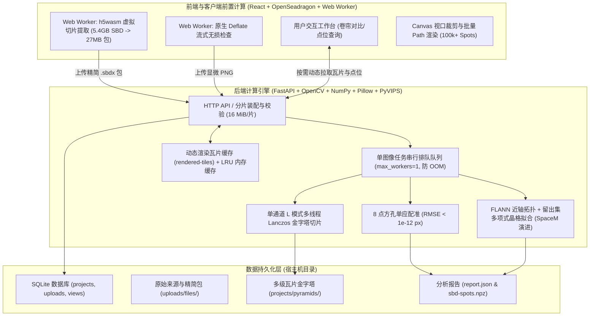
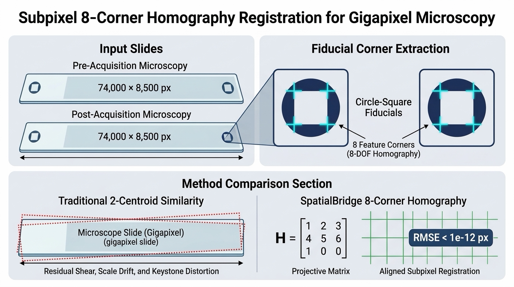
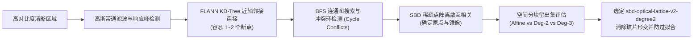
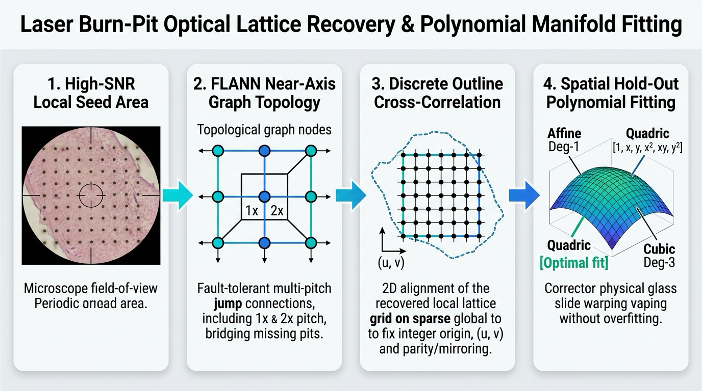

# SpatialBridge 技术架构与计算机视觉算法解析

[← 返回文档索引](README.md) | [返回 README](../../README.md)

SpatialBridge 是一套专为**单细胞/高分辨率 MALDI 质谱成像与显微图像跨模态空间配准**设计的系统。本文档深入解析其底层计算机视觉算法、坐标链几何学、流式切片引擎以及端侧前置计算架构。

---

## 1. 总体架构与数据流转

系统分为**浏览器轻量前置层**、**FastAPI 核心计算服务**与**持久化数据存储**三层：

---

## 2. 核心计算机视觉算法深度解析

### 2.1 标志物亚像素单应配准（8 点方孔算法）

#### 痛点与挑战
显微图单张尺寸通常高达 $73,000 \times 8,500$ 像素（约 6.3 亿像素），在机械平台长轴扫描拼接时，两端存在微小但不可忽略的**进给误差、比例尺漂移、剪切角与梯形失真**。
传统的刚体变换或相似变换（4 个自由度：平移 $(\Delta x, \Delta y)$、旋转 $\theta$、各向同性缩放 $s$）只能利用两个标志物的几何中心：

$$\begin{bmatrix} x' \\ y' \\ 1 \end{bmatrix} = \begin{bmatrix} s\cos\theta & -s\sin\theta & t_x \\ s\sin\theta & s\cos\theta & t_y \\ 0 & 0 & 1 \end{bmatrix} \begin{bmatrix} x \\ y \\ 1 \end{bmatrix}$$

该模型无法表达剪切和透视形变，导致长轴边缘处的点位映射出现数个像素的累积偏差。

#### 算法实现机制
1. **多阈值双极性轮廓树分析 (`detect_markers`)**：
   - 采用多级阈值（步长 15，覆盖 35 到 221）分别在正相与反相二值化下检测轮廓树（`cv2.RETR_TREE`）。
   - **外轮廓筛选**：计算轮廓圆形度 $C = \frac{4\pi \cdot \text{Area}}{\text{Perimeter}^2} > 0.65$。
   - **内轮廓筛选**：使用多边形逼近（`cv2.approxPolyDP`，公差设为周长的 3.5%），严格要求为凸四边形，且宽高比在 $0.65 \sim 1.4$ 之间。
   - **面积比约束**：要求外轮廓与内方孔的面积比满足 $3 < \frac{\text{Area}_{\text{outer}}}{\text{Area}_{\text{inner}}} < 12$。
   - **亚像素矩中心计算**：通过空间矩（`cv2.moments`）精确提取质心坐标，并应用非极大值抑制（NMS，50 px 距离抑制）。
2. **特征角点提取与相位枚举 (`order_quad`)**：
   - 提取每个方形内孔的 4 个物理顶点，两个标志物合计获取 **8 个高信噪比特征点**。
   - 由于检测器无法直接确认方孔顶点的绝对起始相位与绕向，算法遍历 4 种循环位移与顺逆时针镜像排列，组合出所有的拓扑对应方案。
3. **8 自由度单应矩阵拟合 (`cv2.findHomography`)**：
   - 利用 8 个点求解单应矩阵 $H \in \mathbb{R}^{3 \times 3}$：
     $$p' \sim H p \quad \text{其中} \quad H = \begin{bmatrix} h_{11} & h_{12} & h_{13} \\ h_{21} & h_{22} & h_{23} \\ h_{31} & h_{32} & 1 \end{bmatrix}$$
   - 以角点重投影 RMSE 作为评分标准选取最优配准方案。在实测数据中，中心重投影 RMSE 达到浮点极限 $\sim 10^{-13}\text{ px}$。

---

### 2.2 激光灼烧坑检测与光学晶格流形拟合

激光灼烧坑（Laser Ablation Burn Pits）是 MALDI 激光脉冲在载玻片或生物组织表面形成的微米级凹坑。

#### 算法实现机制
1. **近轴拓扑恢复 (`trace_lattice`)**：
   - 针对组织较厚区域灼烧坑对比度低、易漏检的问题，系统借鉴 SpaceM 的拓扑恢复思想，不进行全图盲目检测，而是从局部信噪比最高的区域切入。
   - 使用 OpenCV FLANN 建立 4 棵随机 KD-Tree（`cv2.flann_Index`），按激光步长 $pitch$ 沿横向与纵向检索近邻候选节点。
   - 允许跳过 1 到 2 个缺失节点（即距离为 $1\times, 2\times, 3\times pitch$），建立有向网格图。
   - 执行广度优先搜索（BFS），统计回路冲突（Cycle Conflicts），确保恢复出的晶格结构无逻辑矛盾。
2. **离散轮廓互相关定位 (`match_outline`)**：
   - SBD 中记录了采集斑点的稀疏轮廓（由于仅在组织覆盖区激发激光，轮廓具有天然的不规则几何形状）。
   - 将恢复出的局部整数网格索引与 SBD 稀疏轮廓进行 2D 离散互相关计算，确定全局整数行列坐标 $(u, v)$ 与镜像翻转标志。
3. **空间留出集多项式曲面模型选择 (`evaluate_coordinate_model`)**：
   - 为消除载玻片在长焦镜头下的非线性微翘曲，系统引入多项式基函数拟合：
     - **Degree 1 (Affine)**: $[1, x, y]$（3 项）
     - **Degree 2 (Quadric)**: $[1, x, y, x^2, xy, y^2]$（6 项）
     - **Degree 3 (Cubic)**: $[1, x, y, x^2, xy, y^2, x^3, x^2y, xy^2, y^3]$（10 项）
   - **空间留出集（Spatial Hold-out Cross-Validation）**：将点位按空间区域进行 $K$ 折分块（而非随机打乱，防止空间自相关导致误差虚低）。
   - 评估各模型在未参与拟合区域的预测 RMSE 与 $p95$ 误差。实测证明：**Degree-2 模型**能在消除物理翘曲的同时杜绝边缘发散与过拟合。

---

### 2.3 闭环多模态坐标链验证

SpatialBridge 建立了多模态严格闭环映射矩阵链：

$$\text{SBD World} \xrightarrow{M_{\text{W2B}}} \text{板图像素} \xrightarrow{M_{\text{B2H}}} \text{热图像素} \xrightarrow{M_{\text{H2A}}} \text{采集后显微像素} \xrightarrow{H_{\text{A2P}}} \text{采集前显微像素}$$

- **一致性门禁**：利用 SBD 中的 `OriginalCoordinates`（原始电机步进计数值）进行独立的闭环反向投影检验，若闭环重投影误差 $p95 \ge 1.0\text{ px}$，则标记警告或拦截，确保科学实验数据的高度可靠性。

---

### 2.4 亿级像素多尺度瓦片金字塔与反向透视采样

#### 内存解耦与切片生成 (`tiles.py`)
- **内存优化**：显微图原生为灰度图。加载时严格强制为单通道 `L` 模式（$74,000 \times 8,500 \times 1\text{ byte} \approx 630\text{ MB}$）。如果错误转换为 RGBA 格式，单图内存将瞬间膨胀至 $2.52\text{ GB}$。
- **多线程下采样**：采用多线程 Lanczos 插值生成 $256 \times 256$ 瓦片。切片编码为 PNG 格式期间会释放 Python GIL，因此可跑满多核 CPU（默认利用最多 8 个工作线程）。

#### 实时反向单应透视采样 (`pyramid_tile`)
- 前端 OpenSeadragon 视口在缩放、旋转或平移时，后端不预先渲染整张变形后的大图，而是按请求的切片位置 $(z, x, y)$ 进行**反向投影逆变换**：
  $$p_{\text{source}} = H^{-1} p_{\text{target}}$$
- 仅从源金字塔中读取相交的小瓦片（`read_pyramid_region`），在内存中拼接微小局部后调用 `cv2.warpPerspective` 输出当前切片，并写入 `rendered-tiles` 缓存目录。该机制使得数十亿像素的超大图可以在毫秒级完成实时卷帘对比。

---

## 3. 客户端前置轻量计算架构

为了避免将数十吉字节的原始文件上传至服务器造成网络与存储拥塞，系统在前端浏览器中执行了前置轻量计算：

### 3.1 基于 WebAssembly 的 SBD 虚拟切片提取
- 工业级 SBD（HDF5 格式）通常包含海量连续原始质谱光谱，体积常在 $5\text{ GB} \sim 20\text{ GB}$。
- 前端通过 Web Worker 运行 `h5wasm 0.10.3`，利用 Emscripten `WORKERFS` 虚拟文件系统挂载用户本地 `File`。
- **按需分段读取**：底层通过 `Blob.slice` 进行只读随机偏移寻址（每次读取上限 4 MiB），不将全文件载入浏览器内存。
- 仅提取空间拓扑相关的子树（`Registrations`、`MeasurementRasterIndices`、`Normalizations`、`OpticalImages`），将其打包为仅约 $27\text{ MB}$ 的 `.sbdx` 精简包上传。浏览器 WASM 线性内存占用仅约 **24 MB**。

### 3.2 浏览器原生 Deflate 流式无损检查
- 显微 PNG 在上传前由前端 Worker 利用浏览器原生 `CompressionStream` 与 `DecompressionStream` 检查流式 IDAT 数据。
- **保守复用策略**：若检测到原图已是高压缩比输出（重压无收益或收益小于 3%），则直接原样上传，避免无意义的浏览器重压缩与服务器解压开销。

---

## 4. 关键算法配置与性能指标汇总

| 算法阶段 | 核心技术 / 库 | 关键参数 / 模型 | 性能表现 / 精度 |
| :--- | :--- | :--- | :--- |
| **标志物定位** | OpenCV `findContours` + 形态学 | 阈值步长 15，圆形度 $> 0.65$，面积比 $3\sim 12$ | 检出率 $100\%$，抗低光照与噪声 |
| **双图配准** | OpenCV `findHomography` | 8 点方孔角点拟合，4 相位遍历枚举 | 重投影 RMSE $< 10^{-12}\text{ px}$ |
| **晶格重构** | FLANN KD-Tree + BFS 拓扑遍历 | 容忍 1~2 个断点，循环冲突检测 | 毫秒级恢复完整网格拓扑 |
| **曲面拟合** | 空间留出集多项式拟合 | `sbd-optical-lattice-v2-degree2`（6 参数） | 消除玻片微翘曲，留出集 $p95 < 1\text{ px}$ |
| **瓦片切片** | Pillow / PyVIPS + ThreadPool | $256 \times 256$ 瓦片，单通道 `L` 模式，8 线程 | 6.3 亿像素双图切片约 1~2 分钟 |
| **在线渲染** | `cv2.warpPerspective` 局部切片逆投影 | 按需局部四边形采样，落盘缓存 | 瓦片请求响应时间 $< 30\text{ ms}$ |
| **端侧 SBD 提取** | WebAssembly (`h5wasm`) + Worker | 只读切片遍历，输出 `.sbdx` 精简包 | 5.4 GB 输入仅耗 24 MB 内存，几秒完成 |
