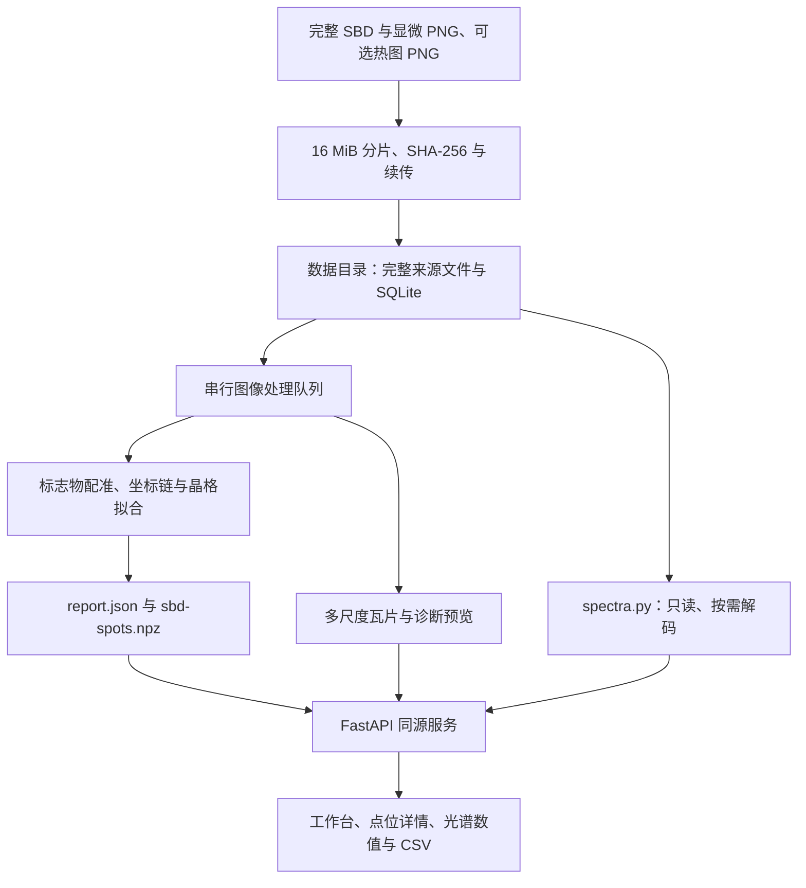
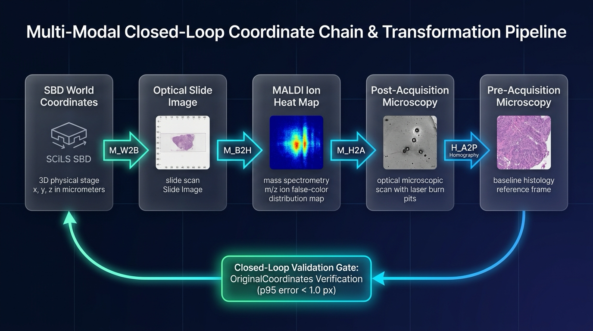

# SpatialBridge 技术架构

[← 返回文档索引](README.md) | [返回项目首页](../README.md)

SpatialBridge 的空间配准与质谱读取共用项目和 SBD 点位编号。配准负责建立显微图与采样网格的对应关系；质谱读取保留文件数值语义，按需返回平均谱、单点谱或质量窗口信号。

## 1. 总体架构与数据流

浏览器使用 React、OpenSeadragon 和 Canvas；FastAPI 同时提供生产前端、API、瓦片、处理预览与 CSV。常规运行只有一个应用进程：

```bash
npm --prefix frontend run build
.venv/bin/spatialbridge serve --data-dir ./workspace-data --frontend-dir frontend/dist --port 8000
```

Vite 是可选开发工具，见[部署与运维](deployment.md)。



`app.py` 负责接口和任务编排；`registration.py`、`integration.py`、`lattice.py`、`heatmap.py`、`tiles.py` 与 `spectra.py` 承担计算和数据读取。SQLite 保存项目、上传及人工标注等状态；项目目录保存报告、图像缓存和可选 `spectra-source.json`。

## 2. 显微图与空间配准

### 标志物单应变换

`registration.py` 的标志物检测使用多阈值、正反极性轮廓树，结合圆形度、内孔四边形和面积比例筛选标志物。两个标志物各提供四个方孔角点，合计八点。

配准枚举角点循环相位、绕向与标志物配对，调用 `cv2.findHomography` 求解：

$$p' \sim H p, \quad H \in \mathbb{R}^{3\times3}.$$

候选需通过有限性与局部方向检查。评分使用角点中位数、p95 和标志物中心误差；正常输入优先保持左右配对。报告同时给出中心 RMSE 与角点误差，应区分其含义。某些参考数据的中心残差接近浮点精度，但这不代表组织区域或全图达到同等独立精度，单应变换也不能描述任意非刚性形变。


### 坐标链与 raster

空间链可表示为：

$$\text{SBD World} \rightarrow \text{板图像素} \rightarrow \text{热图像素} \rightarrow \text{采集后像素} \rightarrow \text{采集前像素}.$$

板图通常从 SBD 读取。板图与热图纹理匹配后，以 `OriginalCoordinates` 做独立一致性检查；raster 的 `PixelToWorld`、可逆性、回算误差及显微图覆盖范围写入报告。矩阵显式约定 `xy` / `yx`，避免以数组行列顺序隐式决定方向。

参考样本 raster 0 的一致性 p95 小于 1 px。其他 raster 或有效校准域外的点不能据此认定已映射，需检查报告。纹理匹配只能证明几何相似性，同次采集仍需核对来源。



### 灼烧坑与光学晶格

`lattice.py` 借鉴 SpaceM 从清晰区域恢复规则晶格的思路：

1. 从高对比区域的带通响应检测候选节点。
2. 用 FLANN 近轴邻接和图遍历恢复整数网格，容忍缺失节点并记录回路冲突。
3. 与 SBD 非对称稀疏轮廓互相关，确定原点、方向与镜像。
4. 对仿射、二阶和三阶归一化多项式做空间分块留出验证。

候选需通过与晶格间距相关的中位数、p95、分区误差和模型折叠/边界检查。从合格低阶模型开始，升阶还要求 p95 至少改善 15%，且分区 p95 恶化不超过 10%。当前参考数据选择二阶模型；这不是所有输入的固定结果，也不构成对过拟合的绝对保证。

`coordinate_model` 是权威位置模型；旧矩阵只保留仿射近似。网格四角由同一模型求值，局部响应峰用于确认和诊断，不逐点移动或重编号。


## 3. 大图处理与浏览

图像密集任务经 `ThreadPoolExecutor(max_workers=1)` 串行执行，避免多个超大图项目同时解码造成内存峰值叠加。金字塔构建尽可能保留灰度通道，避免全幅提前膨胀为 RGBA；可选 pyvips 加速大图处理。

`tiles.py` 生成 256×256 多尺度瓦片。请求配准图层时，后端反向映射目标瓦片，仅读取相交源瓦片并局部 `warpPerspective`，随后落盘缓存。浏览器按可见范围与屏幕密度筛选网格，Canvas 批量绘制足迹。性能依赖数据、硬件、缓存状态与视野，不能把特定机器上的帧率或耗时视为保证。

工作台支持采集前、采集后与卷帘视图，自动延续当前标签页会话的视野和观察设置。人工标注单独持久化。点位详情以 spot ID 连接几何与光谱，原始编号不会因排序或显示抽样改变。

## 4. 上传与来源文件

### 完整 SBD

`ProjectHome.tsx` 对 SBD 直接使用原始 `File`，完整文件进入现有分片上传、校验、合并与续传流程。配准不需要把所有光谱读入内存，但服务器仍需保存整个文件并为上传合并预留磁盘空间。

`h5wasm`、`.sbdx` 提取和后端还原代码仍用于历史格式兼容；当前网页不再自动把 SBD 替换为仅含坐标、raster、归一化因子与板图的精简包。旧项目读取光谱时必须取得完整 SBD。

### PNG 无损优化

Worker 用浏览器原生 Deflate API 流式重压 IDAT，保持解压扫描行、尺寸、位深及非 IDAT 块。已充分压缩或收益不足的 PNG 直接复用，不通过 Canvas 改写原图。优化有大小和能力限制；超限或失败回退原文件。详细机制和既有测试见[配准方法与输出](algorithm.md#浏览器本地无损优化-png)。

### 路径与迁移

数据目录内来源及缓存采用 `data://` / `project://` 相对引用。目录导入和后端本地 SBD 关联可引用外部绝对路径，关联不会复制文件。跨机器部署时必须保证这些路径存在或重新关联；容器内需要相应只读挂载。

## 5. 独立 SBD 光谱读取

`backend/spatialbridge/spectra.py` 基于 h5py、NumPy、zlib 和 struct 独立实现 SCiLS Peaks 质心格式读取，运行时不依赖 imzy、外部源码目录或 Bruker SDK。每次请求持有独立只读 HDF5 句柄，读取全局轴、较小偏移表及所选压缩块。

| 数据表示 | 返回内容 | 语义 |
| --- | --- | --- |
| 保存的平均光谱 | 全局轴与 `MeanSpectra` 强度 | 直接读取，保留区域/归一化标识，不重算 |
| spectrum-major | 精确单点质心 m/z 与配对强度 | 还原定点质量编码，点 ID 从 0 开始 |
| image-major | 多目标的逐点信号 | 按全局分箱中心的闭区间筛选，sum/max 聚合 |

单点 m/z 参数位于 zlib 流后的 `<Bdd` 尾部；索引数据由字节平面还原小端 delta 再累加。读取器校验偏移、长度、压缩流、索引范围和数值有效性。

离子提取支持 1–32 个目标，全部窗口合计最多 4,096 个分箱，可筛选保存的区域并以 `raw / Values[spot_id]` 归一化。非正因子输出 0。全局分箱与精确质心不是完全等价表示；稀疏缺失填 0 也不证明物理信号不存在。

`SpectraPanel` 自动检查项目完整 SBD，仅在缺失或用户选择更换时显示路径编辑器。`SpotSpectrum` 在选点后自动请求对应点的光谱，取消旧请求以避免快速切点混入旧数据。两个组件提供数值与 CSV；尚未实现从提取通道生成原生多离子热图。现有 PNG 热图叠加只采样图片 RGB。

当前主要验证范围是 SCiLS Lab 12.01、Version 36 Peaks 样本，尚无完整 SCiLS 功能或导出等价性验证。解码细节、API、测试命令与已知峰见 [SBD 质谱读取](sbd-spectra-reader.md)。
